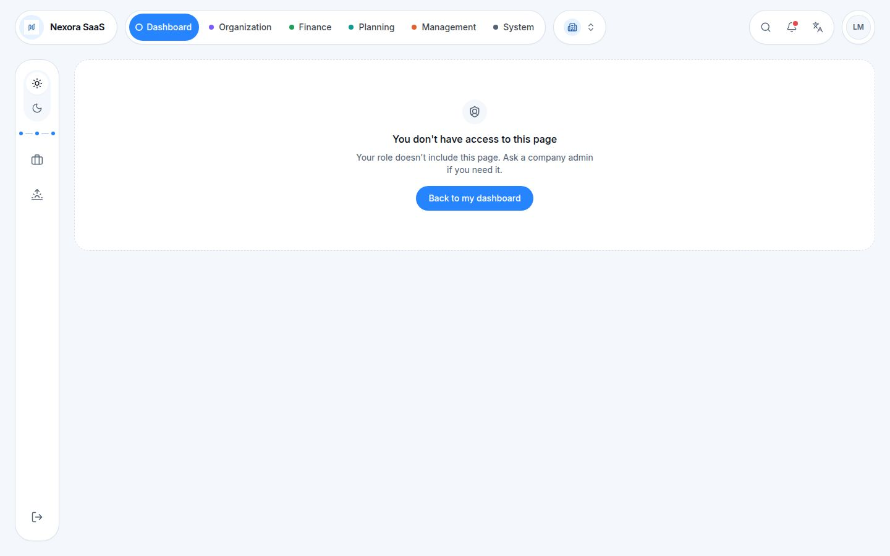

# Nexora: full audit of the front end, security and connections (October 2026)

_Follows `docs/AUDIT_PRE_BACKEND_2026-10.md` and `docs/API_AUDIT_2026-10.md`. Written before updating the API contract and starting the backend._

## Status

| Finding | Status |
|---|---|
| G-01 project delete, G-02 landing page, G-03 old links, G-04 task mentions, G-05 company export | ✅ Fixed in A1 |
| Everything else | ⏳ Planned in `docs/PLAN_FIXES_API_SECURITY_2026-10.md` |

## 1. Summary

The front end is in good shape. Types are strict, lint and tests are clean, the business rules sit in tested functions, and the browser-side security (CSP, headers, redirects, exports) is solid. All the remaining security work belongs to the server, as planned.

This audit found **2 high**, **9 medium** and **12 low** items. The two high items are about **connections between features**, not about security:

1. A project that has hours and invoices can be deleted. Its records are then left pointing at nothing (verified: 92 hours, 9 invoices, 2 pages).
2. An employee who signs in lands on "You don't have access to this page" (verified in the browser).

| Area | Grade | In one line |
|---|---|---|
| Browser security | 🟢 Good | Nonce CSP, strict headers, safe redirects, protected exports. Web-address fields need one more check. |
| Server security (to build) | 🟡 To define | CSRF approach, file uploads, audit events, plan limits and 2FA must go into the API contract. |
| Connections between features | 🟠 Gaps | Project delete, landing page, old links, task mentions, company export, plan limits. |
| Code quality | 🟢 Good | 4 `any`, 0 `@ts-ignore`, lint clean, 822 tests. About 100 unused exports and 460 unused texts to clean. |
| Accessibility | 🟢 Good | 19 of 20 main pages pass axe. Settings has unlinked labels. |
| Tests | 🟡 Mixed | Logic is well covered (API 91%, rules 96%). Screens 49%, PDFs 10%. |

## 2. Scope and checks run

- Whole front end on branch `claude/funny-goodall-yva4ib` (main + PR #129): 715 source files, about 101,000 lines, 75 pages, 56 API modules, 65 stored collections, 420 error codes.
- `tsc --noEmit`, `eslint --max-warnings 0`, `vitest --coverage` (129 files, **822 tests, all passing**), `npm audit`, `npm outdated`, i18n sync.
- Scripts: an unused-export scan over `src/`, an unused-translation scan, and a scan of which modules write to the audit log.
- Throwaway tests for the data findings (G-01), run and then deleted.
- Browser (production build, demo mode): sign-in as the employee Lina, the old `/billing` link, and axe (WCAG 2 A/AA) on 20 main company pages.

Every finding below was checked in the code. **(verified)** means it was also reproduced by a test or in the browser.

## 3. Security

| # | Level | Finding | Where | Fix | Who |
|---|---|---|---|---|---|
| S-01 | Medium | **Web-address fields accept any scheme.** The client website uses `z.url()`, which accepts `javascript:` and `data:` (verified with Zod). The contact's LinkedIn and the CSV/Excel import do no check at all. React 19 blocks `javascript:` links when it renders them, but `data:` and other schemes pass. These values also go into PDFs and the portal. Task links are already checked (`isWebUrl`). | `client-form.tsx:73`, `contact-edit.tsx:120`, `crm-import.ts:309,326` | Use `isWebUrl` (http/https only) on every URL field, in the form and in the import. The server checks the same. | Front + back |
| S-02 | Medium | **No CSRF approach is defined.** The app sends cookies with every request (`withCredentials: true`) and sends no anti-CSRF header. The API contract says nothing about CSRF, CORS or `SameSite`. | `myapi/client.ts:18`, `API_AUDIT §2` | Choose one: `SameSite=Lax/Strict` plus an `Origin` check, or a double-submit token (axios `xsrfCookieName` / `xsrfHeaderName`). Write it in the API contract. | Back (+1 line front) |
| S-03 | Medium | **File uploads have no allow-list.** Client files and task attachments accept any type. They are kept as data URLs, and the 500 KB limit is checked only in the browser. | `client-files.tsx`, `client-files-api.ts`, `task-collab-api.ts` | Server side: allow-list of types, size limit, virus scan, download with `Content-Disposition: attachment` from a separate domain or signed URLs. | Back |
| S-04 | Medium | **Some sensitive actions are not in the audit log.** Missing: the full company export in Settings (it includes salaries and cost rates), "delete all data", client files added or removed, project delete, task delete and purge. | `settings-page.tsx:306,333`, `data-export-api.ts`, `client-files-api.ts`, `work-projects-api.ts:115,365` | Add audit entries. On the server, only the owner may export or delete everything. | Front + back |
| S-05 | Low | **No automatic lock or sign-out when idle.** The passcode lock exists but is manual. The app holds financial and HR data. | `lock-screen.tsx` | Decide the session lifetime and idle time on the server. Optionally lock the screen after N minutes. | Back + front |
| S-06 | Low | **There are two 2FA mechanisms, and the real one is not wired.** The profile has an e-mail 2FA switch (a profile field). The console uses its own demo setup key. The TOTP endpoints `/auth/2fa/setup|enable|disable|verify` exist in `auth-apis.ts` but no screen calls them. | `two-step-dialog.tsx`, `two-factor-gate.tsx`, `auth-apis.ts` | Pick one method (TOTP recommended) for the backend and wire both screens to it. | Decision + front |
| S-07 | Low | **Revoking a session does not reach the browser.** `useAuthSocket` (listens for revoked sessions) is never mounted. A revoked user stays in until their next `401`. | `hooks/socket/use-auth-socket.tsx` | Mount it in the dashboard layout once the socket server exists. | Front, later |
| S-08 | Info | Demo mode is blocked in production builds (CI check). If `ALLOW_DEMO_BUILD` were ever set in production, the known demo accounts would sign in with any password (demo data only). | `demo-mode.ts`, CI | Keep it off in production. | Ops |
| S-09 | Info | Production dependencies: **0 vulnerabilities**. Development tools have a few (e.g. `@modelcontextprotocol/sdk`, `body-parser`, `deepmerge`); all are fixed by `npm audit fix`. | `package.json` | Run `npm audit fix` in a small PR. | Front |

Still open from the previous audit, server-side by design: **H2** (who acts comes from the session, not the request) and **H3** (sensitive fields left out of responses by role).

### What is already good

- **CSP** with a nonce per request and `'strict-dynamic'`, no `unsafe-eval` in production, `connect-src` limited to the API and socket origins, `frame-ancestors 'none'`, `object-src 'none'` (`lib/security/csp.ts`, `proxy.ts`).
- **Headers:** HSTS with preload, `X-Frame-Options: DENY`, `nosniff`, COOP, a strict `Referrer-Policy` and `Permissions-Policy` (`next.config.mjs`).
- **Login redirect** (`?next=`): only same-site app paths are accepted (`lib/auth/safe-redirect.ts`).
- **No HTML injection:** the only `dangerouslySetInnerHTML` is the chart's CSS, which is sanitized. Formatted text only links to `http(s)` addresses.
- **Exports:** CSV and Excel cells that start with `= + - @` are neutralized (`export-data.ts`, `xlsx.ts`).
- **Sessions:** cookies are HttpOnly by design, and demo tokens live in a separate cookie.
- **Secrets:** none in the repository; `.env*` is ignored except `.env.example`.

## 4. Gaps and things not connected

| # | Level | Finding | Fix |
|---|---|---|---|
| G-01 | **High** | **A project with hours and invoices can be deleted (verified).** Deleting *Orbit* left **92 time entries, 9 invoices and 2 project pages** pointing at a project that no longer exists. Task comments, attachments, saved views and client requests are left behind too. By contrast, deleting an *employee* is correctly refused when they have history (`employees-api.ts:94`). (`work-projects-api.ts:115`) | Refuse the delete when the project has hours, invoices, quotes or expenses, with a new error code, and suggest *Close project* instead. When the delete is allowed, also remove its pages, comments, attachments, views and requests. |
| G-02 | **High** | **Employees land on "No access" after signing in (verified, screenshot below).** Everyone is sent to `/dashboard/overview`, which needs *View analytics*. (`safe-redirect.ts:8`) | Send each person to the first page their role can open (`/dashboard/my-work` for employees). |
| G-03 | Medium | **Old `/billing` and `/subscriptions` links send company users to a page reserved for the Nexora team (verified).** (`app/[locale]/billing/page.tsx`, `subscriptions/page.tsx`) | Send company users to `/dashboard/subscription` (their own subscription) and the Nexora team to the console page. |
| G-04 | Medium | **@mentions in task comments are saved but never shown.** `findMentions` stores `mentionIds` on the comment, but no bell item, list or badge reads them. @mentions in client notes do reach the bell. (`task-collab-api.ts:72`, `inbox.ts`) | Add a "mentioned in a task" item to the bell, like the client-note one. |
| G-05 | Medium | **The full company export (data requests, AUD-04) misses 6 newer collections:** client files, client requests, cycles, project pages, task views and table views. The module list is kept by hand. (`tenant-modules.ts`) | Add them, plus a test that fails when a module with a collection is neither listed nor marked as platform-only. |
| G-06 | Medium | **Plan limits are not enforced.** Plan features are only text, so a *Starter* company can use the *Business* features (DGI e-invoice, suppliers, deals, forecast). `PlanGuard`, `useFeatureFlag` and `useUsage` exist but no page uses them. When seats are full the company only gets a notice; adding one more person is not refused. (`nexora-catalog.ts`, `platform-seats-api.ts`, `guard/plan-guard.tsx`) | Decide what each plan includes. The server refuses with `403 upgrade_required` (the app already handles it) and `409 err_seatsFull` when a person is added past the limit. The menu hides what the plan does not include. |
| G-07 | Low | **Global search (Ctrl+K) does not cover everything.** It finds pages, clients, employees, projects, tasks, invoices and quotes, but not contacts, leads, deals, suppliers, supplier bills, expenses, project pages, follow-ups or requests. | Add them, or use one server search endpoint. |
| G-08 | Low | **Some events never reach the bell:** a deal gone stale, a quote about to expire, a supplier bill coming due, an action item given to someone from a meeting page. | Add them to the bell (or to the server notifications). |
| G-09 | Low | **Functions with no screen:** personal data export and account deletion (`gdpr-apis.ts`), deleting a project template (`deleteTemplateApi`), notification preferences and sound (`use-notification-settings`, `use-notification-sound`), usage meters (`use-usage`). | Wire them, or drop them from the contract. |
| G-10 | Low | **Client merge can miss bank-import matches and saved reports.** Those modules are not loaded when the merge runs. (`clients-api.ts:161`) | Load them in the merge (the server merge does it in one transaction). |

_Lina (employee) right after signing in: "You don't have access to this page" (G-02)._

## 5. Code review

| # | Level | Finding | Fix |
|---|---|---|---|
| C-01 | Medium | **Unused code:** about 100 exports outside the UI kit are never used (left-overs in `lib/demo-data/index.ts`, old hooks, utils, types, 2 PDF helpers), plus 51 unused UI-kit exports. About **460 of 5,800 texts** look unused (mostly starter-template texts; some may be built dynamically, so check before removing). | One clean-up PR, keeping what the backend plan still needs (G-09). |
| C-02 | Low | **Large files:** `work-billing-api.ts` (808 lines), `platform-billing-api.ts` (772), `project-detail-page.tsx` (708), `settings-page.tsx` (650), `client-form.tsx` (633), `use-dashboard-nav.tsx` (619). | Split them while wiring each module to the server. |
| C-03 | Low | **Accessibility:** 19 of 20 pages pass axe. On **Settings**, 19 fields have labels that are not linked to their inputs (critical for screen readers, `settings-page.tsx:66-74`). The axe check in CI only covers the console. | Link the labels (`htmlFor`/`id`) and add the main company pages to the CI axe job. |
| C-04 | Low | **Texts not translated:** the auth pages (placeholders, register messages such as "Password must be at least 10 characters"), the developer page cards, and a few screen-reader labels in the UI kit. | Move them to the 9 language files. |
| C-05 | Low | **Tests:** rules and API helpers are well covered. Screens (49% of the lines loaded) and PDFs (10%) much less. Branches overall: 68%. | Add screen tests for the money flows (invoice, payment, credit note) and one PDF snapshot test. |
| C-06 | Low | 19 direct `console.*` calls bypass `logger`. There are 20 lint suppressions, almost all `exhaustive-deps`, each with a reason. | Route them through `logger`. |

Fixed during this audit (in PR #129): the developer guide said "there is no proxy" (the optional `API_PROXY_TARGET` proxy exists), and a doc comment sat above the wrong declaration in `work-projects-api.ts`.

## 6. What goes into the API contract update

The next step is updating `docs/API_AUDIT_2026-10.md`. These findings change the contract:

| Topic | To add |
|---|---|
| CSRF / CORS / cookies (S-02) | The chosen method, `SameSite`, allowed origins, and the header the app sends |
| Web addresses (S-01) | http/https only for `website`, `linkedin` and task links; `400 err_badUrl` |
| Files (S-03) | Upload endpoint, allowed types, size limits, scan, signed download links |
| Audit events (S-04) | The list of actions the server must log, including export and delete-all |
| Sessions (S-05, S-07) | Lifetime, idle timeout, the socket event when a session is revoked |
| 2FA (S-06) | One method and its endpoints |
| Project delete (G-01) | `409 err_projectHasHistory` and what is deleted with a project |
| Plans (G-06) | Features per plan, `403 upgrade_required`, `409 err_seatsFull` |
| Notifications (G-04, G-08) | The event types the bell needs, including task mentions |
| Company export (G-05) | Every collection is included; the list comes from the database, not a hand-kept list |
| Search (G-07) | Optional `GET {ws}/search?q=` across all records |

## 7. Suggested order

1. **Front-end quick fixes, one small PR:** G-02 landing page, G-03 old links, G-01 refusing the project delete, S-01 URL checks, C-03 Settings labels, G-05 export list and its test, G-04 task mentions in the bell, S-04 audit entries.
2. **API contract update** with section 6.
3. **Clean-up PR:** C-01 unused code and texts, S-09 `npm audit fix`, C-04 texts.
4. During the backend work: S-02, S-03, S-05, S-06, S-07, G-06, G-07, C-02.
